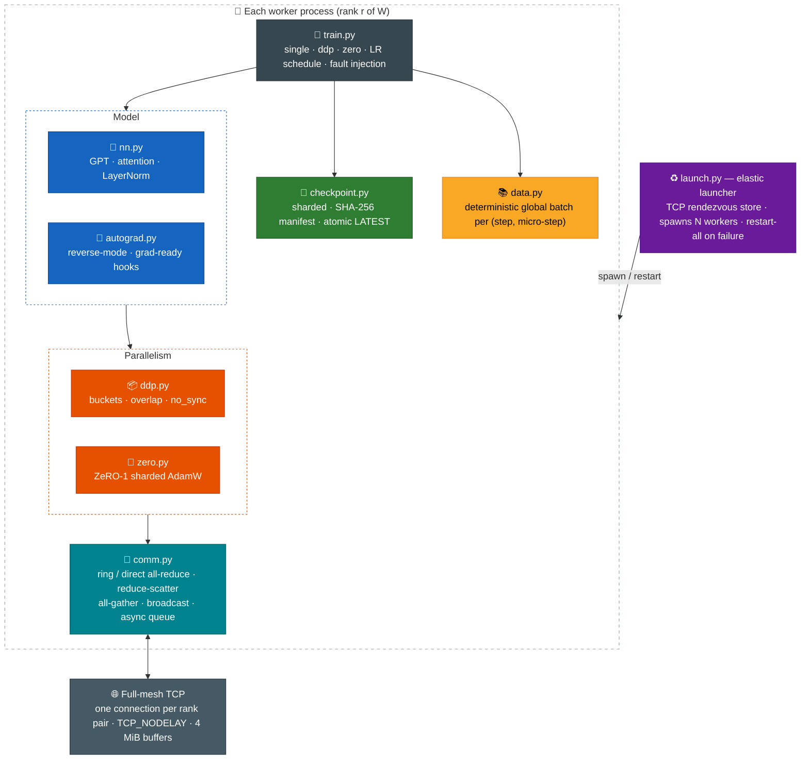
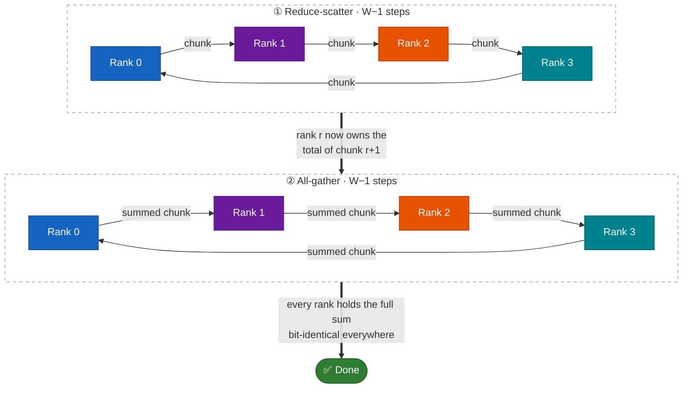
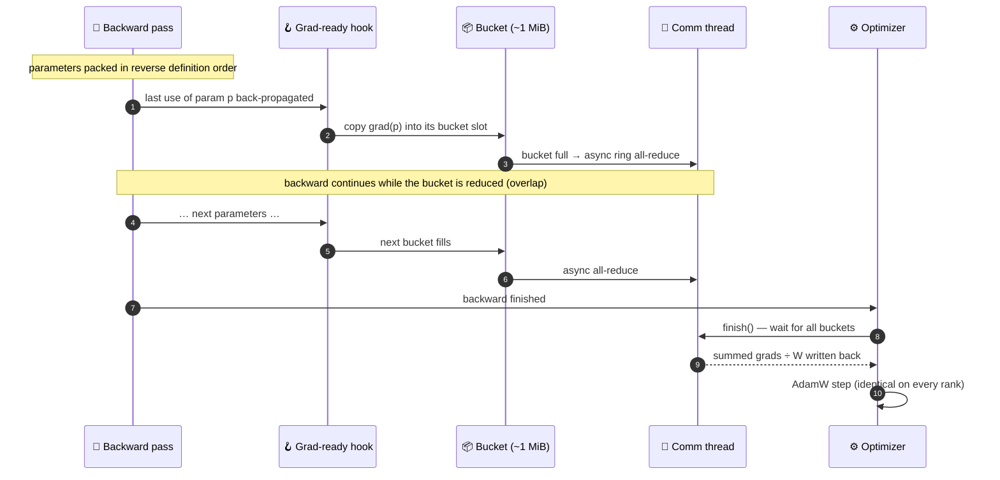
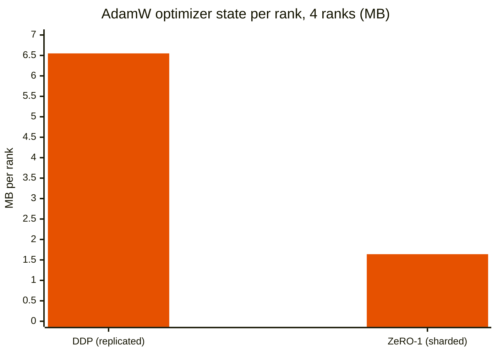
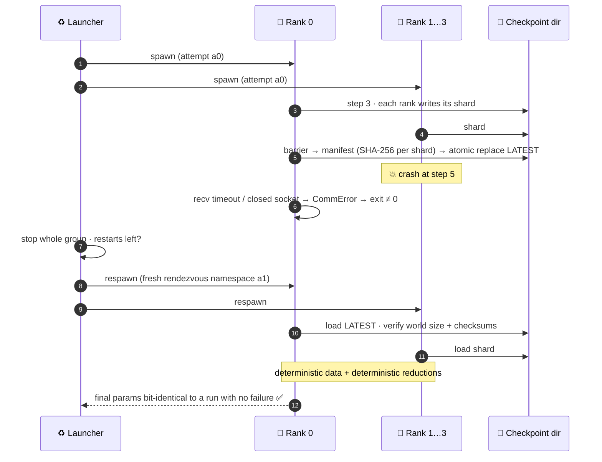
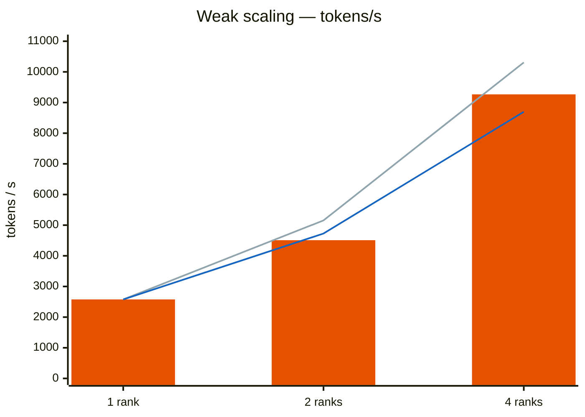
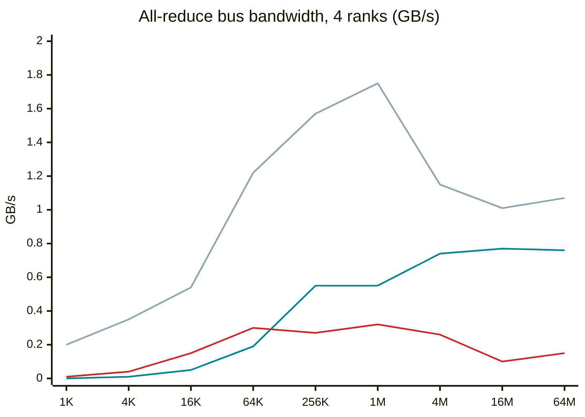
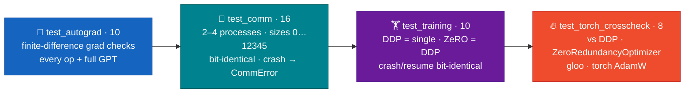

<div align="center">

# 🌐 dtrain — Distributed Training from Scratch

### DDP, ZeRO-1, ring all-reduce and elastic fault tolerance — built from first principles and checked against PyTorch

**Own autograd engine · own TCP collectives · gradient bucketing · sharded optimizer · checksummed checkpoints · crash → restart → bit-identical resume**

<br/>


</div>

---

## ⚡ TL;DR

`dtrain` trains a small GPT across multiple processes **without any deep-learning framework**. Every layer of the distributed-training stack — the stuff hidden inside `torch.distributed`, DeepSpeed and `torchrun` — is written by hand and verified:

- 🧠 **Autograd engine** on NumPy, with grad-ready hooks that fire exactly once per parameter (what DDP needs to start communicating early).
- 🔗 **Collectives over raw TCP** — ring and direct all-reduce, reduce-scatter, all-gather, broadcast — with failure detection and a fixed summation order, so every rank gets **bit-identical** results.
- 📦 **DDP** with ~1 MiB gradient buckets, comm/compute overlap and `no_sync()` gradient accumulation.
- 🧩 **ZeRO-1** — optimizer state sharded across ranks: **4× less optimizer memory** at 4 ranks.
- 💾 **Sharded, SHA-256-checksummed, atomic checkpoints**.
- ♻️ **An elastic launcher** that restarts the whole group after a worker crash. Training then resumes **bit-identically** to a run that never failed.

> [!NOTE]
> **Verified against the real thing.** Gradients match `torch.nn.parallel.DistributedDataParallel` to **≤ 1.6e-15** (float64); ZeRO-1 matches `ZeroRedundancyOptimizer` to **≤ 3.9e-14**; the ring all-reduce is **bit-identical to gloo** at 2 ranks.

---

## 🏗️ Architecture



| Module | Responsibility |
|---|---|
| `autograd.py` | Reverse-mode autograd on NumPy; hooks fire when a leaf's gradient is final |
| `nn.py` | Linear, LayerNorm, causal self-attention, GPT |
| `optim.py` | AdamW on flat arrays (shared by DDP and ZeRO), global-norm clipping |
| `comm.py` | Rendezvous store, full-mesh process group, ring/direct collectives, async work queue |
| `ddp.py` | Parameter broadcast, gradient buckets, overlap, `no_sync` |
| `zero.py` | Flat parameter buffer, reduce-scatter grads, sharded AdamW, all-gather params |
| `checkpoint.py` | Per-rank shards, SHA-256 manifest, atomic `LATEST` pointer |
| `data.py` | Char-level corpus; global batch is a pure function of (seed, step, micro-step) |
| `launch.py` | Elastic launcher with `--max-restarts` |

---

## 🔗 Ring all-reduce

Each rank's buffer is split into W chunks. Two phases of **W − 1 steps** each move only **2(W−1)/W** of the data per rank — bandwidth-optimal, independent of W.



- **Deterministic:** the summation order is fixed, so every rank — and every rerun — gets bit-identical results.
- **Full duplex:** each connection has a dedicated sender thread, so a rank sends to its successor while receiving from its predecessor. Messages ≤ 64 KiB are sent inline to skip the thread hand-off.
- **Safe framing:** every message carries `(sequence number, byte count)`; a mismatch raises `CommError("protocol desync")` instead of silently misreading data.
- **Failure detection:** every receive has a timeout (`DTRAIN_TIMEOUT`, default 60 s). A dead peer makes survivors raise `CommError` — never hang.
- **Direct all-reduce** is the baseline: one step, but (W−1)× the data. It wins below ~64 KiB; the ring wins above.

---

## 📦 DDP — gradient bucketing and overlap



`no_sync()` skips communication on gradient-accumulation micro-steps — and accumulated training equals training on the larger batch (tested).

---

## 🧩 ZeRO-1 — sharded optimizer state




dtrain splits the flat buffer **evenly** (every rank holds exactly 441,856 B in the 4-rank float64 cross-check), while PyTorch's `ZeroRedundancyOptimizer` assigns whole tensors (422,912 – 458,752 B per rank).

---

## ♻️ Fault tolerance — crash, restart, resume bit-identically



- The global batch for each (step, micro-step) is a **pure function of the seed**, so a resumed run sees exactly the data it would have seen.
- A **corrupted shard is rejected** by its checksum (tested).
- With no restarts left, the failing exit code propagates.

---

## 📈 Results

Measured on one 4-vCPU VM (Xeon @ 2.80 GHz), one BLAS thread per rank, TCP loopback. Details: [`docs/benchmarks.md`](docs/benchmarks.md).

### Correctness

| Check | Result |
|---|---|
| DDP (4 ranks) vs one process, same global batch | equal to **≤ 1e-10** (float64); max loss diff **2.4e-7** over 300 float32 steps |
| ZeRO-1 vs DDP | equal to **≤ 1e-10**; optimizer state per rank cut **4×** |
| Crash at step 5 → auto-restart → resume | final parameters **bit-identical** to the uninterrupted run |
| vs PyTorch DDP (gloo, CPU), same model / data / seed | gradients **≤ 1.6e-15** (float64), **≤ 1.4e-6** (float32) |
| vs `ZeroRedundancyOptimizer` | parameters **≤ 3.9e-14** after 50 steps (float64) |
| Ring all-reduce vs gloo, 2 ranks | **bit-identical** |
| Checkpoint → exit → resume at 4 ranks | dtrain bit-identical; torch DDP + gloo drifts ~5e-16 (documented) |

### Weak scaling (GPT, ~0.8 M params, 8 × 64 tokens per rank)



<sub>🟧 bars = ZeRO-1 · 🟦 blue line = DDP (no overlap) · grey line = ideal linear scaling</sub>

| Configuration | Ranks | Tokens/s | Speed-up | Comm wait / step |
|---|---|---|---|---|
| Single process | 1 | 2,577 | 1.00× | — |
| DDP, no overlap | 2 | 4,727 | 1.83× | 5.2 ms |
| ZeRO-1 | 2 | 4,509 | 1.75× | — |
| DDP, overlap | 4 | 8,192 | 3.18× | 24.2 ms |
| DDP, no overlap | 4 | 8,697 | 3.37× | 15.8 ms |
| **ZeRO-1** | 4 | **9,266** | **3.60×** | — |

ZeRO-1 wins at 4 ranks because it does one reduce-scatter and one all-gather over a single flat buffer, instead of one all-reduce per bucket.

> 🔬 **Negative result, reported honestly:** overlapping all-reduce with backward is *slightly slower* here. The communication and autograd threads share one Python process and compete for the GIL, and NumPy kernels on these small tensors are too short to hide communication. A C/C++ comm thread would be needed.

### All-reduce vs OpenMPI 4.1 (4 ranks, float32, bus bandwidth)



<sub>🟦 teal = dtrain ring · ⬜ grey = OpenMPI 4.1 · 🟥 red = dtrain direct</sub>

- **Large messages:** the Python ring reaches **~70–80 % of OpenMPI's bandwidth** (0.76 GB/s at 64 MiB, 71 %).
- **Small messages:** 10–50× OpenMPI's latency — each of the 2(W−1) ring steps pays Python and thread hand-off overhead.
- **Ring vs direct:** direct wins below ~64 KiB; at 64 MiB the ring is **5×** faster because direct moves (W−1)× more data.

---

## 🧪 Testing

`python -m pytest` → **36 tests in ~30 s**, plus **8 PyTorch cross-check tests** when `torch` is installed (**44 / 44 passing** in the 2026-10-15 run). Every distributed test launches **real OS processes**.



| Suite | Highlights |
|---|---|
| `test_autograd.py` | float64 finite-difference checks for broadcasting ops, batched matmul, reductions, GELU, LayerNorm, causal attention, embedding with repeated indices, cross-entropy; the grad-ready hook fires **exactly once** for a parameter used twice |
| `test_comm.py` | ring and direct all-reduce on 2/3/4 processes for sizes 0, 1, 2, 3, 5, 7, 64, 1000, 12345 (empty and uneven chunks), within 1e-12 of NumPy and bit-identical on every rank; a peer crashing mid-collective makes the survivor raise instead of hang |
| `test_training.py` | DDP = single process (≤ 1e-10); ZeRO = DDP with optimizer state exactly 2 × 8 × ⌈n/4⌉ bytes; bucket size, overlap and ring/direct give identical results; preempt-and-resume and crash-and-restart are **bit-identical**; a corrupted shard is rejected |
| `test_torch_crosscheck.py` | gloo all-reduce, `DistributedDataParallel` (AdamW and SGD), `ZeroRedundancyOptimizer`, `torch.optim.AdamW`, checkpoint/resume |

<details>
<summary><b>🔍 Why dtrain and PyTorch differ at all (rounding-level analysis)</b></summary>

- **All-reduce:** at 3+ ranks, 32–44 % of elements differ in the last bit — only the order of additions differs, and both are within 1 ulp of the exact sum.
- **AdamW:** with *identical* gradients the two optimizers already differ by 6.7e-6 (float32), because they compute the bias correction in a different order (`sqrt(v / b2t)` vs `sqrt(v) / sqrt(b2t)`), and Adam's update has derivative lr/eps = 1e5 near eps.
- **Plain SGD** removes the optimizer effect: the step-1 difference is 1e-17 (float64) and grows ~1e4× over 50 steps at the same rate in both precisions — training dynamics amplifying a rounding perturbation, not a bug.

Full write-up: [`docs/torch_crosscheck.md`](docs/torch_crosscheck.md).

</details>

---

## 🚀 Quick start

```bash
pip install -e '.[dev]'
python -m pytest                                     # 36 tests, ~30 s

# single process (downloads tiny-shakespeare, SHA-256 checked)
python -m dtrain.train --mode single --steps 200 --warmup 10

# 4-rank DDP
python -m dtrain.launch --nproc 4 -- python -m dtrain.train --mode ddp --steps 200 --warmup 10

# 4-rank ZeRO-1 that crashes at step 50, restarts itself and resumes from the checkpoint
python -m dtrain.launch --nproc 4 --max-restarts 2 -- python -m dtrain.train --mode zero \
    --steps 200 --ckpt-dir ckpt --ckpt-every 20 --resume --fail-at-step 50
```

<details>
<summary><b>🔥 PyTorch cross-check and benchmarks</b></summary>

```bash
pip install -e '.[torch]'                                       # a CPU build is enough
python -m pytest tests/test_torch_crosscheck.py                 # 8 tests
python benchmarks/run_torch_crosscheck.py --out benchmarks/results/<date>/torch
python benchmarks/torch_report.py benchmarks/results/<date>/torch > docs/torch_crosscheck_tables.md

python benchmarks/allreduce_bench.py                            # + mpirun baseline (pip install -e '.[bench]')
bash benchmarks/scaling.sh
python benchmarks/report.py <date>
```

</details>

---

## 📁 Repository layout

```text
DISTRIBUTED-TRAINING/
├── dtrain/          # autograd · nn · optim · comm · ddp · zero · checkpoint · data · train · launch · torch_ref
├── tests/           # autograd · comm · training · torch cross-check
├── benchmarks/      # all-reduce, scaling and PyTorch cross-check scripts + results/
├── owner/           # GPU scripts: RTX 4060 single-GPU, multi-GPU NCCL
└── docs/            # architecture · testing · benchmarks · limitations · torch_crosscheck · requirements
```

---

## 🧭 Limitations and roadmap

| Area | Today | Next |
|---|---|---|
| Hardware | CPU / NumPy; GPU + NCCL scripts written (`owner/`) but not yet run | Run on an RTX 4060 and multi-GPU NCCL |
| Hosts | Single host over TCP loopback, up to 4 ranks | Multi-host test (plain TCP, should work) |
| Small messages | 10–50× OpenMPI's latency (Python per-step overhead) | C/C++ transport thread |
| Overlap | No gain because of the GIL | Native comm thread |
| Sharding | ZeRO stage 1 only | ZeRO-2/3, tensor and pipeline parallelism, mixed precision |
| Elasticity | Restart-all at a fixed world size | Shrink/grow and re-sharding checkpoints to a new W |
| Rendezvous | Store lives in the launcher (single point of failure), no auth | Replicated store, authentication |

More in [`docs/limitations.md`](docs/limitations.md).

---

<div align="center">

**What `torchrun` + DDP + ZeRO do under the hood — rebuilt, measured, and proven equal to PyTorch.**

<sub>MIT © siddhaantxsingh</sub>

</div>
